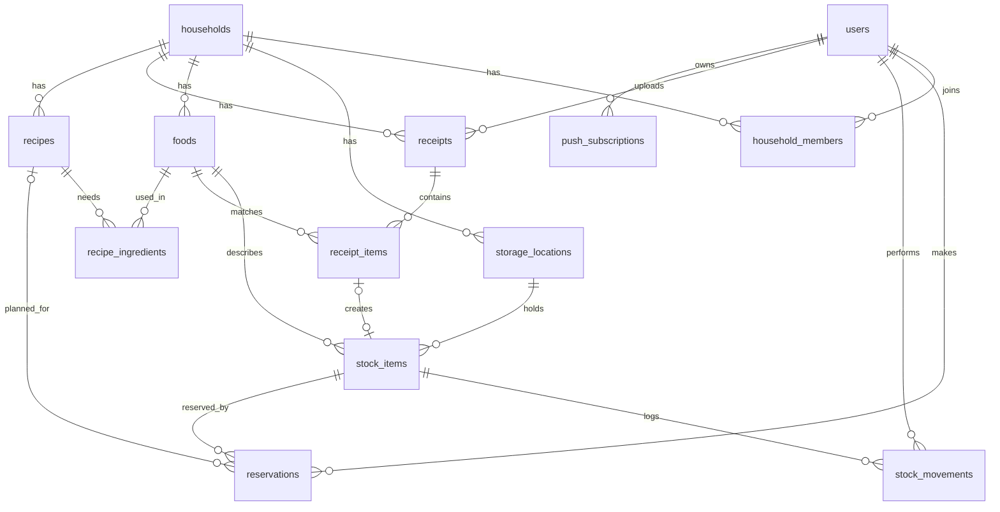

# Database design

PostgreSQL, names in `snake_case`. Quantities are always stored in base units: grams, milliliters or pieces.

## Tables

- **users**: id, email (unique), password_hash, display_name, receipt_consent_given_at (nullable), created_at
- **households**: id, name, invite_code (unique), created_at
- **household_members**: id, user_id, household_id, role (owner, member), joined_at. A user belongs to one household for now; several households are a premium feature.
- **storage_locations**: id, household_id, name, kind (fridge, freezer, pantry, custom)
- **foods**: id, household_id, name, category, base_unit (gram, milliliter, piece). Each household has its own catalog of foods.
- **stock_items**: id, storage_location_id, food_id, quantity (remaining), expiration_date (nullable), receipt_item_id (nullable), created_at
- **stock_movements**: id, stock_item_id, user_id, quantity_change, reason (eaten, spoiled, destroyed, cooked, correction), created_at
- **reservations**: id, stock_item_id, user_id, recipe_id (nullable), quantity, note, status (active, fulfilled, cancelled), created_at
- **receipts**: id, household_id, user_id, store_name, purchased_on, total_amount, items_sum_matches_total, processing_milliseconds, created_at. The photo is never stored.
- **receipt_items**: id, receipt_id, food_id (nullable until confirmed), original_text, name, category, quantity, unit, price, discount, corrected_by_user
- **recipes**: id, household_id, name, instructions, servings, is_predefined, created_at. Predefined recipes are copied into a household when it is created.
- **recipe_ingredients**: id, recipe_id, food_id, quantity
- **push_subscriptions**: id, user_id, endpoint (unique), public_key, authentication_secret

## Rules

- Stock is never deleted. Every decrease is a row in `stock_movements`, and `stock_items.quantity` holds the remaining amount.
- Reservations are made by the person who cooks and can optionally name a recipe.
- When user A looks at recipe R, the quantity of a food that counts as available to A is:
  - the stock quantity,
  - minus all active reservations of other users,
  - minus A's own active reservations made for a different recipe.

  A's own reservations without a recipe, or made for R, stay available to A.
- Recipe price estimate: the latest price per base unit from `receipt_items` of the same food.
