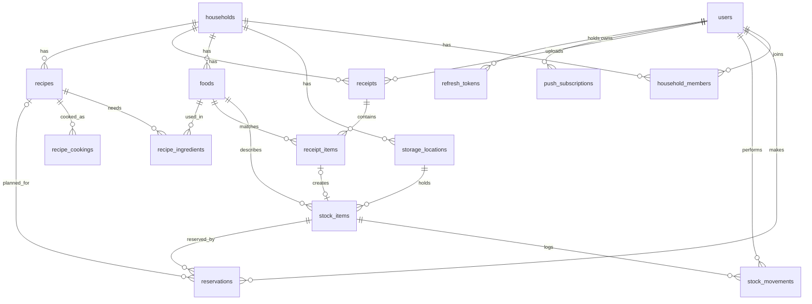

# Database design

PostgreSQL, names in `snake_case`. Quantities are always stored in base units: grams, milliliters or pieces.

## Tables (14)

- **users**: id, email (unique), password_hash, display_name, receipt_consent_given_at, recipe_photo_consent_given_at (nullable), deletion_requested_at (nullable; the account is deleted 14 days later), premium_until (nullable; premium is active while it is in the future, per user), is_guest (account without e-mail, see guest mode), guest_address_hash (nullable; hash of the IP address that created a guest, for the daily limit, cleared on upgrade), last_active_at (set on every sign-in and token refresh; guests inactive for 60 days are deleted by the worker), created_at
- **households**: id, name, invite_code (unique), created_at
- **household_members**: id, user_id, household_id, role (owner, member), notification_hour (6-22, default 8), expiration_warning_days (0-7, default 2), expiration_notified_on (date of the member's last expiration notification), joined_at. Unique per user and household; a user may belong to 1 household (free, guest) or 3 (premium).
- **storage_locations**: id, household_id, name, kind (fridge, freezer, pantry, custom), icon (nullable emoji)
- **foods**: id, household_id, name (unique per household ignoring letter case, as specific as known, for example "Mouka hladká"), generic_name (nullable general kind, for example "Mouka"; recipes will accept any food of the same kind unless they require a specific food), category (fixed list kept in the application), base_unit (gram, milliliter, piece), icon (nullable emoji chosen by the user), energy_kcal, fat, saturated_fat, carbohydrates, sugars, proteins, fiber, salt (nullable, per 100 g or 100 ml, copied from the food catalog or typed from the package), nutriscore_grade (nullable a-e), piece_weight_grams (nullable, converts pieces to grams for recipe nutrition), barcode (nullable, unique within the household; remembered when the food is added after scanning, so the next scan finds it), photo (nullable small image, 256 × 256 WebP or JPEG compressed on the phone, shown instead of the icon), photo_content_type, photo_updated_at (also the version in the signed photo link). Each household has its own catalog of foods.
- **stock_items**: id, storage_location_id, food_id, quantity (remaining), expiration_date (nullable), receipt_item_id (nullable), created_by_user_id (nullable, who added it), created_at
- **stock_movements**: id, stock_item_id, user_id, quantity_change, reason (eaten, spoiled, destroyed, cooked, correction, moved), storage_location_id (where it happened; for a move the source), target_storage_location_id (only for a move), created_at. A move has quantity_change 0.
- **reservations**: id, stock_item_id, user_id, recipe_id (nullable), quantity, note, status (active, fulfilled, cancelled), created_at
- **receipts**: id, household_id, user_id, store_name, purchased_on, total_amount, items_sum_matches_total, processing_milliseconds, receipt_number (nullable, as printed, for spotting duplicates), file_hash (nullable SHA-256 of the scanned file, never the file itself; the same file is recognised before it is sent to the model), created_at. The photo is never stored.
- **receipt_items**: id, receipt_id, food_id (nullable until confirmed), original_text, name, category, quantity, unit, price, discount, corrected_by_user, quantity_is_estimate (the quantity was an estimate the user saved without changing or confirming it; not used for history or the catalog)
- **recipes**: id, household_id, name, instructions, servings, preparation_minutes, is_predefined, icon (nullable emoji), dish_type (nullable: soup, mainCourse, sideDish, dessert, breakfast), is_vegetarian, created_at. Predefined recipes are copied into a household when it is created.
- **recipe_ingredients**: id, recipe_id, food_id, quantity, accepts_any_of_kind (any food with the same generic name and unit counts), is_optional (never counted as missing)
- **join_requests**: id, household_id, user_id (unique: one request per user), rejected_at (nullable; null = waiting), created_at. Approving deletes the request and adds the member.
- **invite_links**: id, household_id, token_hash (unique), created_by_user_id, expires_at (7 days), used_at, used_by_user_id, revoked_at, created_at. One-time links that join without approval.
- **shopping_list_items**: id, household_id, owner_user_id (null = shared list, otherwise the personal list of that user), food_id (nullable, null for free text), name, quantity (nullable, base units), note, recipe_id (nullable, where it came from), created_by_user_id, checked_at, checked_by_user_id, created_at.
- **recipe_scans**: id, household_id, user_id (nullable), photo_count, processing_milliseconds, input_tokens, output_tokens, created_at. One row per successful recipe scan; counts towards the user's limit (free 3 in total, premium 20 a month).
- **rewarded_ad_views**: id, user_id, kind (reward_kind: receiptScan, recipeScan), created_at. Each row adds one scan to the user's limit in the current period; at most 3 a day.
- **product_quantities**: id, store_key (normalized store name), text_key (normalized item text from the receipt), quantity, unit, confirmation_count, updated_at; unique (store_key, text_key, quantity, unit). A catalog shared by all households, without any user or household: every saved receipt item with a confirmed quantity adds one confirmation, and scans fill missing quantities from the most confirmed entry (same store first). Seeded from existing receipts by migration 0021.
- **catalog_products**: id, barcode (unique), name, name_key (normalized name and brand for searching), brand, quantity_text (as in Open Food Facts), quantity and unit (parsed into base units, nullable), category (our food category from the Open Food Facts category tags), popularity (number of scans in Open Food Facts), energy_kcal, fat, saturated_fat, carbohydrates, sugars, proteins, fiber, salt (per 100 g or 100 ml, nullable), nutriscore_grade (nullable), imported_at. Replaced as a whole by each import; no relation to households.
- **receipt_scans**: id, household_id, user_id (nullable), processing_milliseconds, input_tokens, output_tokens, created_at. One row per successful receipt scan; counts towards the user's monthly limit (free 10, premium 60) and shows the Gemini cost.
- **favourite_recipes**: user_id, recipe_id (primary key together), created_at. Personal favourites; deleted with the user or the recipe.
- **recipe_cookings**: id, household_id, recipe_id (nullable, set to null when the recipe is deleted), recipe_name (the name when cooked), user_id (nullable), servings, created_at. One row each time a recipe is cooked; the history survives deleting the recipe.
- **push_subscriptions**: id, user_id, endpoint (unique), public_key, authentication_secret
- **refresh_tokens**: id, user_id, token_hash (unique), expires_at, revoked_at (nullable), created_at

## Rules

- Stock is never deleted. Every decrease is a row in `stock_movements`, and `stock_items.quantity` holds the remaining amount.
- Reservations are made by the person who cooks and can optionally name a recipe.
- When user A looks at recipe R, the quantity of a food that counts as available to A is:
  - the stock quantity,
  - minus all active reservations of other users,
  - minus A's own active reservations made for a different recipe.

  A's own reservations without a recipe, or made for R, stay available to A.
- Recipe price estimate: the latest price per base unit from `receipt_items` of the same food.
- Authentication uses a short-lived access token (30 minutes, JWT) and a refresh token (60 days). Every refresh replaces the refresh token with a new one, so the session stays alive while the app is used. Refresh tokens are stored only as hashes and can be revoked.
