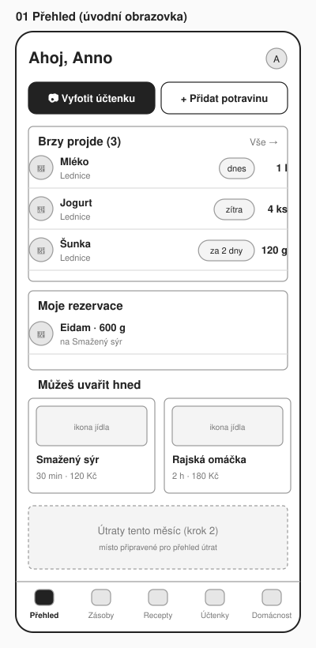
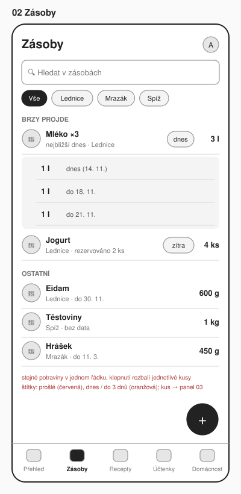
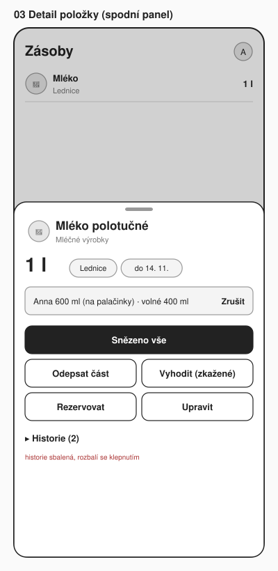
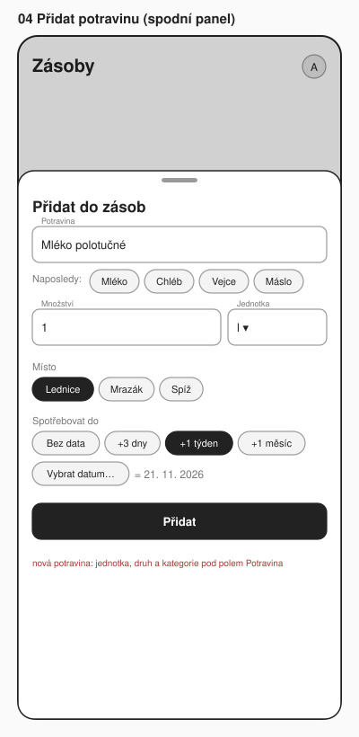
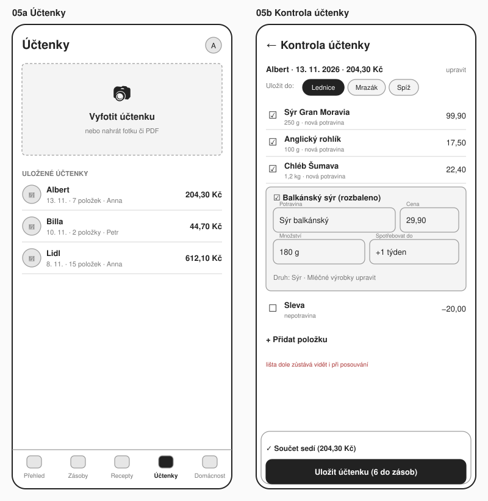
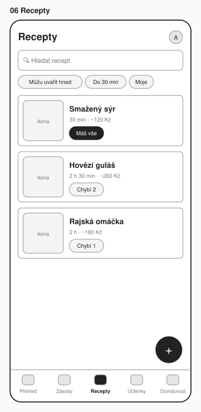
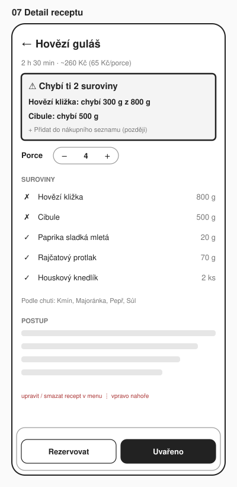
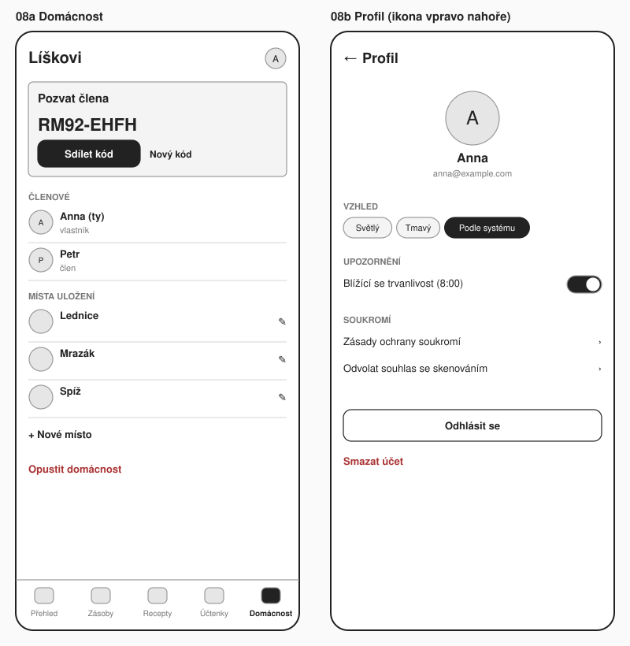
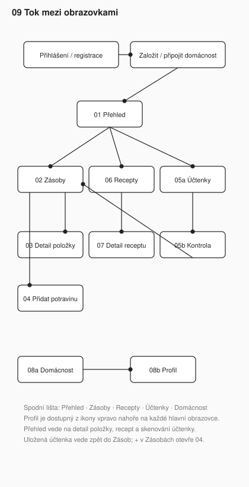

# Wireframes

Low-fidelity wireframes of the redesigned app (the postponed M1 output). They show layout and flow, not colours. Texts are in Czech as in the app. The SVG files are generated by `docs/wireframes/source/screens.py`:

```
python3 docs/wireframes/source/screens.py docs/wireframes
```

## Across the app

- Five tabs in the bottom bar: Přehled, Zásoby, Recepty, Účtenky, Domácnost. On wide screens (900 px and more) the tabs move to a side navigation and content gets a wider column.
- The profile is opened from the round icon in the top right corner of every main screen.
- Category icons next to foods everywhere (dairy, bakery, meat…), so lists can be scanned quickly.
- Details and quick forms open as bottom sheets instead of dialogs, so they can be used with one thumb.
- Empty screens show an icon, one sentence and the main action.
- Light and dark theme: the user chooses Light, Dark or System in the profile; the choice is stored on the device.

## 01 Přehled (home)



The default screen after signing in. Two large actions (scan a receipt, add food), food that expires soon with coloured labels, the user's own reservations and recipes that can be cooked right away. The dashed area is reserved for the spending overview (next step).

## 02 Zásoby (stock)



Search and storage location chips stay. Rows are compact: category icon, name, location or reservation, expiration label and quantity on the right. The same food is shown in one row (for example "Mléko ×3" with the nearest expiration) and tapping it expands the individual items; nothing is merged in the database. The list is split into "Brzy projde" (expired or within 3 days) and "Ostatní". Labels: expired red, today and within 3 days orange.

## 03 Detail položky (item bottom sheet)



Name, category, quantity, location and expiration, reservations with free quantity, then the actions: Snězeno vše as the main button, then Odepsat část, Vyhodit (zkažené), Rezervovat and Upravit. The history is collapsed.

## 04 Přidat potravinu (add food bottom sheet)



Recently used foods as chips, quantity with unit, the storage location as chips and expiration shortcuts (no date, +3 days, +1 week, +1 month, pick a date) with the resulting date shown. A new food shows unit, kind and category below the food field.

## 05 Účtenky (receipts and review)



The receipts tab has one large area for taking a photo or uploading a file and the list of saved receipts. The review shows every item as one compact row (checkbox, name, quantity, price); tapping a row expands its fields. The storage location for all items is chosen at the top. A bar at the bottom stays visible with the sum check and the save button with the number of items going to stock.

## 06 Recepty (recipes)



Recipe cards with an icon, preparation time, price estimate and a "Máš vše" or "Chybí 2" label. Filter chips: Můžu uvařit hned, Do 30 min, Moje.

## 07 Detail receptu (recipe detail)



Missing ingredients stay the most visible part, in a framed box at the top. Servings stepper, ingredients with a tick or a cross, optional ingredients on one line, steps. Reserve and Cooked are in a bar at the bottom that stays visible; editing and deleting move to a menu in the top bar.

## 08 Domácnost and Profil



The household tab keeps the invite code, members and storage locations. Everything personal moves to the profile, which is a menu of sections, each with its own page, so it can grow with new features: Účet (name, e-mail, later password change and reset, deleting the account), Vzhled (theme), Upozornění, Soukromí a data (privacy policy, receipt consent) and O aplikaci (version, contact), plus signing out.

## 09 Flow


